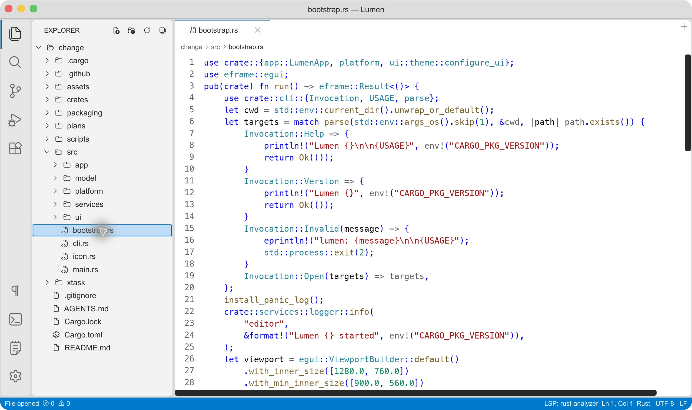
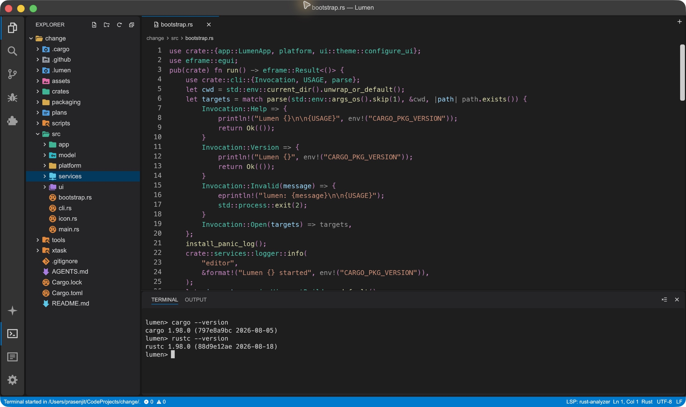
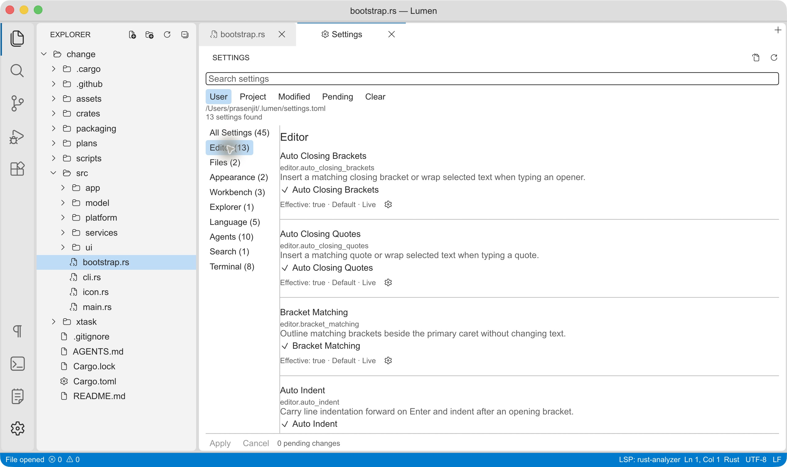

# Lumen

A native desktop code editor built with Rust and egui, inspired by VS Code’s compact workbench. Lumen brings file editing, project search, Git diffs, a terminal, language tools, and optional coding agents (Claude Code and Codex, run natively) into one local application.



*Lumen 0.2.1 on macOS, captured from the current source on October 19, 2026 using the dark theme. Light, high-contrast, and system appearance are also available.*

Lumen is under active development. The default editor uses a shared Rust editing core and cosmic-text/Swash shaping. Native IME, screen-reader behavior, and Windows runtime acceptance still have open validation work; see [known limitations](#known-limitations).

## Contents

- [Features](#features)
- [Build and run](#build-and-run)
- [Command-line usage](#command-line-usage)
- [Workbench and file management](#workbench-and-file-management)
- [Editing and navigation](#editing-and-navigation)
- [Search and replace](#search-and-replace)
- [Language tools](#language-tools)
- [Source control](#source-control)
- [Terminal and output](#terminal-and-output)
- [Tasks](#tasks)
- [Coding agents](#coding-agents)
- [Settings](#settings)
- [Saving and recovery](#saving-and-recovery)
- [Large-file performance](#large-file-performance)
- [Keyboard shortcuts](#keyboard-shortcuts)
- [Known limitations](#known-limitations)
- [Development](#development)

## Features

| Area | Available today |
| --- | --- |
| Workbench | Resizable Explorer with colored per-type file and folder icons, editor tabs and split groups, breadcrumbs, command palette, recent files and folders |
| Editing | Syntax highlighting, multiple cursors, column selections, undo/redo, indentation, bracket/quote pairing, code folding |
| Navigation | Fuzzy Quick Open, Go to Line/Column, tab switching, language-server definitions and references |
| Search | Per-document Find/Replace and background workspace search with replacement previews |
| Language tools | Optional Rust and Go language servers, diagnostics, completion, hover, symbols, formatting, rename, semantic tokens |
| Git | Status badges, staged/working diffs, staging, hunk staging, commits, amend, confirmed discard, push and fast-forward pull |
| Terminal | Integrated PTY shell with terminal emulation and configurable typography/colors |
| Tasks | Project and personal tasks in `tasks.toml`: guided editor, dependency groups, terminal or captured output tabs, background services, inputs |
| Coding agents | Native Claude Code and Codex sessions in one list, with chats in editor tabs, permission cards, per-session model/effort/permission settings and cached transcripts; the older ACP adapter panel remains as a fallback |
| Settings | Searchable User/Project configuration, sparse TOML overrides, themes and editor/terminal preferences |
| File safety | Dirty-buffer prompts, optional Auto Save, recovery snapshots, external-change detection, staged file writes |

The Run and Debug activity lists and runs tasks; it is not a debugger. The Extensions activity icon is present, but does not imply VS Code extension compatibility.

## Build and run

### Requirements

- A stable Rust toolchain with Cargo and a native compiler/linker. The workspace uses Rust edition 2024.
- A desktop environment and graphics support suitable for eframe/egui.
- Git on `PATH` for Source Control features.
- Optional language-server and coding-agent executables for those integrations; basic editing does not require them.

Clone the repository and start the editor:

```sh
git clone https://github.com/prasenjit-net/lumen-editor.git
cd lumen-editor
cargo run --release -- . src/main.rs Cargo.toml
```

Use release builds when evaluating responsiveness. `cargo run` without `--release` is useful during development but is not representative of optimized large-file performance.

### macOS

Build an app bundle and open it:

```sh
cargo xtask bundle --release
open target/Lumen.app
```

The helper builds the binary before packaging it. Add `--offline` when all dependencies are already downloaded. `CARGO_TARGET_DIR` is respected.

Lumen uses the real macOS traffic-light controls and desktop menu bar, with a themed title strip. Shortcuts use Command where appropriate.

### Windows

With Rust and its native build tools installed:

```powershell
cargo build --release
.\target\release\lumen-editor.exe .
```

Windows uses native menu, title-bar, and caption controls. Primary shortcuts use Ctrl.

### Linux

Build and run from a graphical desktop session:

```sh
cargo build --release
./target/release/lumen-editor .
```

Native build dependencies depend on your distribution and desktop setup. If compilation reports a missing system library, install the corresponding development package and retry.

### Release artifacts

The repository’s [Release workflow](.github/workflows/release.yml) builds platform artifacts and SHA-256 checksums. Published builds are not signed or notarized. See the repository’s [Releases](https://github.com/prasenjit-net/lumen-editor/releases) for available versions.

## Command-line usage

The executable built by Cargo is named `lumen-editor`; examples below assume it is on your `PATH`:

```sh
lumen-editor [OPTIONS] [PATH[:LINE[:COLUMN]]]...
lumen-editor .
lumen-editor src/main.rs:42:7 README.md
lumen-editor --help
lumen-editor --version
lumen-editor -- ./filename-starting-with-a-dash
```

- One folder becomes the workspace. Additional folders are reported and skipped.
- Files open in argument order; the last file is activated. Already-open paths activate their existing tab.
- Line and column are 1-based. A path that actually exists with a `:number` suffix is opened literally.
- Relative paths resolve from the launch directory. Missing files are reported rather than created.
- Failed targets appear in Output and the status bar without preventing other targets from opening.
- Explicit paths bypass the Reopen Last Folder preference. Unknown options exit with status 2; `--` ends option parsing.

Each launch creates its own window. Forwarding arguments to an existing window, Finder/Explorer file associations, and `open -a` file delivery are not wired up yet. The Windows GUI release executable does not display help/version output in a console.

## Workbench and file management

Open a folder to populate Explorer, or open individual files without a workspace. Use the activity bar to switch panels, the command palette to discover actions, and breadcrumbs to navigate the current path. Editor tabs can be reordered and split into groups; each document retains its editing state.

Files and folders get colored icons by exact name (`Cargo.toml`, `Dockerfile`, `.gitignore`), compound suffix (`.d.ts`, `.spec.ts`), then extension, with about 300 extensions and about 30 well-known folder names (`node_modules`, `src`, `tests`, `docs`, `target`...). Unknown types show a generic file icon.

Explorer’s header provides **New File**, **New Folder**, **Refresh**, and **Collapse All**. Creation and rename use inline inputs: Enter confirms, Escape cancels, and errors remain available for correction.

- Creation starts in the selected folder, a selected file’s parent, or the workspace root.
- A nested relative name such as `src/components/button.rs` creates missing parent folders. A trailing slash creates a folder.
- **New Text File** (`Cmd/Ctrl+N`) and the editor’s plus button create untitled buffers independently of Explorer.
- Context menus provide cut/copy/paste, path copying, reveal in the system file manager, rename, and delete.
- Rename and move update descendant editor paths while preserving unsaved text.
- Delete asks for confirmation and uses Trash/Recycle Bin. It never falls back to permanent deletion. Dirty affected buffers remain open as untitled documents; the workspace root is protected.
- Create, rename, and paste do not overwrite existing destinations. Copying into an occupied folder generates a unique copy name. Failed recursive copies can leave a partial destination and report that failure.

Explorer currently supports single selection and an in-app file clipboard. Bulk selection, filesystem drag/drop, operation undo, and symlink copying are not implemented.

## Editing and navigation

The default shared editor owns text mutations, cursor sets, and undo history. Tabs preserve their cursor, history, and scroll state. Undoing to saved content clears the dirty marker; edits never silently save unless Auto Save is configured.

### Text and selections

- Multiple cursors: Option/Alt-click adds a cursor; Option/Alt-drag adds a selected range.
- Column selections: Shift+Option/Alt-drag.
- Occurrences: `Cmd/Ctrl+D` selects the next occurrence; `Cmd/Ctrl+Shift+L` selects all occurrences.
- Line-end cursors: Shift+Option/Alt+I adds cursors at the ends of selected lines.
- Tab/Shift+Tab indent or outdent touched lines once, including overlapping selections.
- Matching clipboard rows distribute across multiple selections in document order; a different row count pastes the full text at each cursor.

Auto indentation, indentation detection, width, spaces/tabs, bracket/quote pairing, selection wrapping, and matching-bracket outlines are configurable. Bracket matching skips recognized comments and strings even when syntax colors are disabled.

Long lines scroll horizontally without wrapping; the gutter stays fixed. Click a line number to select a line, Shift-click to extend, or drag for a range. Dragging beyond the viewport auto-scrolls until release, a blocking dialog, or document bounds.

Gutter fold controls collapse bracket-delimited and Python/YAML indentation blocks. Fold state belongs to each open tab. Find, Go-to, and caret entry reveal hidden targets without changing document contents or history.

### Copy, cut, and paste

With no selection, Copy copies the logical line without moving the caret or dirtying the buffer. Cut removes the logical line in an undoable operation, including special handling for the last line and its preceding terminator. Existing LF/CRLF endings are retained.

A line copied or cut in this Lumen session can paste above the current line while preserving the original caret column. Selected-text replacement remains ordinary paste. This behavior depends on exact-text session metadata; identical text copied by another app is indistinguishable, and metadata does not survive restarting Lumen.

Requested paste validates document identity, revision, selection, focus, and input mode before delivery. Clipboard failures do not mutate text. Focused keyboard paste currently rereads the native clipboard synchronously at its event position to preserve line endings; this can block briefly and cannot recover an earlier clipboard snapshot if another app changes it. Generic input fields and pointer-transition batches use ordinary platform transport. These paths do not establish universal native event-ordering or request-ID correlation for untagged platform events.

### Quick navigation

Use Quick Open (`Cmd/Ctrl+P`) for fuzzy filename/path search. Workspace files rank ahead of external recent files. Recent-file history is bounded and saved under `~/.lumen/recent-files.toml` (the corresponding user directory on Windows).

The workspace index skips ignored and generated trees. Reopen the folder to refresh it after external changes. Go to Line/Column (`Cmd/Ctrl+G`) accepts `line:column`, both 1-based. Use the command palette (`Cmd/Ctrl+Shift+P`) for additional workbench actions.

## Search and replace

### In the active document

Find (`Cmd/Ctrl+F`) seeds from selected text or the caret’s word. Enter/Shift+Enter navigate matches; Escape returns focus to the editor. Case sensitivity, whole-word matching, Replace, and Replace All are available. Queries/options are separate for each document. Replace All is one undoable edit.

Document search is literal: regex, selection-scoped search, preserve-case replacement, and multiline input controls are not implemented. Case-insensitive matching uses Unicode lowercasing with byte-boundary mapping, not full Unicode case folding. Replacements that would split a grapheme are rejected with feedback.

### Across the workspace

Open Search with `Cmd/Ctrl+Shift+F`, enter a literal query, and press Enter. A cancellable background scan reports progress and groups results by folder/file. Use Match Case, Whole Word, and include/exclude globs to narrow matches.

Replace supports a file, folder, or all results. It shows a paginated diff preview before explicit confirmation. Files open in an editor are skipped, and files changed since the scan are not silently overwritten. Failures remain visible in Search.

Scans skip symlinks, `.git`, `target`, binary/non-UTF-8 files, and files larger than 2 MiB. Nested `.gitignore` patterns are supported; global Git excludes and `.git/info/exclude` are not read. `search.exclude` adds persistent User/Project exclusions, while the panel’s exclude field adds temporary patterns.

## Language tools

Syntax highlighting works independently of language servers. Recognized languages include Rust, Go, C/C++, Python, JavaScript/TypeScript, shell, JSON, TOML, YAML, Markdown, HTML, CSS, CMake, SQL, and INI. Special filenames include `CMakeLists.txt`, Makefiles, `Dockerfile`/`Containerfile`, ignore files, `.editorconfig`, `.env` variants, `Cargo.lock`, and extensionless `README`/`CHANGELOG`.

Optional language-server support currently targets **Rust (`rust-analyzer`)** and **Go (`gopls`)**. Install the appropriate server separately and make it discoverable on `PATH`, or set its absolute executable path in User Settings. Project configuration cannot choose language-server executables.

Depending on server capabilities, Lumen exposes diagnostics and Problems, hover, Go to Definition, references, completion, signature help, document symbols, semantic highlighting, formatting, and symbol rename. Language edits have review/application workflows; availability depends on the active language and server response. Check the status bar and Output when startup or requests fail.

Settings include `language.rust.enabled`, `language.go.enabled`, their `server_path` overrides, and `language.server.startup_timeout_seconds`. Lexical/parser highlighting remains available when a server is missing or disabled.

## Source control

Open a folder inside a Git repository and select Source Control. Lumen shows status groups and Explorer badges, with Git work performed outside the UI thread.

- Open staged, working, or untracked changes in a side-by-side diff.
- Working comparisons have a read-only Git side and an editable working-document side. Staged comparisons are read-only.
- An already-open dirty document is reused without replacing its text. A clean diff-only preview is dropped on close; dirty previews retain their file tab.
- Stage/unstage individual files or groups. Independent working-tree hunks can be staged when the editor has no unsaved changes; untracked files use whole-file staging.
- Commit staged changes with a message. **Amend** updates the latest local commit; an empty message retains its subject. Amend rewrites local history and does not push automatically.
- Push uses Git’s configured remote/upstream. Pull uses `git pull --ff-only` and is blocked while workspace documents have unsaved edits. Authentication is provided by your Git environment.
- Discard asks for confirmation and restores eligible tracked files and their index state from `HEAD`. It preserves untracked files and does not run `git clean`.

The visible panel refreshes to detect external Git changes. Reopen a comparison to update its snapshot; change markers are hidden when the editable text differs from that snapshot. Merge-resolution UI and a history browser are not implemented.

## Terminal and output



Toggle the terminal with **Ctrl+`** on every platform or use the Terminal menu/activity button. It starts in the workspace directory, or the home directory when no folder is open. The native PTY uses `SHELL` on Unix (falling back to `/bin/sh`) and `COMSPEC` on Windows (falling back to `cmd.exe`).

The terminal uses an Alacritty-based emulation core. Settings control its font family, font size, line height, cursor style/blink, ANSI palette, auto-scroll, and panel divider. Input while the terminal owns focus goes to the shell rather than document editing.

Output (`Cmd/Ctrl+Shift+U`) is a separate workbench log for startup, file, language-server, agent, and other application feedback. It supports copying and clearing logs.

## Tasks

The **Run and Debug** activity is a task runner: it lists your tasks, runs them, and shows each run in its own tab beside TERMINAL and OUTPUT. It does not debug (no breakpoints or stepping).

Tasks live in TOML files: `<folder>/.lumen/tasks.toml` for the opened folder, and `~/.lumen/tasks.toml` for personal tasks. Create and edit them from the sidebar (**New Task**, double-click or **Edit** in the row menu) or open the file with **Tasks: Open … Tasks File (TOML)**. The form edits one task and keeps comments and unknown keys; saving refuses to overwrite a file that changed on disk.

```toml
schema_version = 1

[[inputs]]                      # asked for once per run, used as ${input:env}
id = "env"
type = "choice"                 # text | choice | secret (masked, never saved)
prompt = "Environment"
options = ["staging", "prod"]

[[tasks]]
id = "build"
label = "Build"
type = "process"                # a program and literal arguments (one per entry)
command = "cargo"
args = ["build", "--release"]
group = "build"
is_default = true               # used by "Tasks: Run Build Task"

[[tasks]]
id = "dev"
label = "Dev server"
type = "shell"                  # one command string for the shell; runs in a terminal
command = "npm run dev"
is_background = true
[tasks.background]
ready_pattern = "Local:"        # dependents wait until this text appears
ready_timeout_seconds = 60

[[tasks]]
id = "verify"
label = "Verify"
type = "compound"               # only orders other tasks
depends_on = ["build", "dev"]
depends_order = "sequence"      # or "parallel"
on_failure = "fail_fast"        # or "continue"
```

- **Variables:** `${workspaceFolder}`, `${workspaceFolderBasename}`, `${file}`, `${fileDirname}`, `${fileBasename}`, `${env:NAME}` and `${input:ID}`. A variable with nothing to resolve to (no folder, no saved file) is an error, never an empty string. `$${` writes a literal `${`.
- **Running:** double-click a task, use **Run** in the row menu, or the palette (**Tasks: Run Selected / Rerun Last / Run Build / Run Test Task**). A workspace task shows its command for review the first time, and again whenever what it executes changes. Personal tasks run without that prompt. Nothing runs when a file is opened or a folder is loaded.
- **Output:** shell tasks (and `transport = "pty"`) run in a pseudo-terminal rendered by the terminal emulator and accept typing; `process` tasks capture stdout and stderr as text. Output is bounded; hiding the panel never stops a task.
- **Stopping:** Stop asks the task and everything it started to stop, then kills them after a short grace period. Closing a running tab, changing folder and quitting ask first.
- **Groups:** tasks with `depends_on` run as a group with its own summary tab. The whole graph is validated and resolved before anything starts, shared prerequisites run once, and at most four processes run at a time. Background services keep the group open until you stop it.
- **Problems:** `problem_matcher = "cargo"` (also `gcc`, `go`, `tsc`) or a `[tasks.problem_matcher]` table with a regex using named groups `file`, `line`, `message` (optional `column`, `severity`) lists file:line problems from the output in the Problems panel. Clicking one opens the file at that position; a rerun replaces that task's problems only. Matching never decides whether a task succeeded.
- **Templates and Run Task:** a new task can start from a template (Cargo build/test/clippy, npm script, blank). The command palette lists every defined task as **Run Task: …**, recently started ones first. Output can be copied or saved to a file (what Lumen retained, including any truncation notice).
- **Secrets:** secret inputs are masked and never saved; Lumen does not show them in previews or its logs, but a program can still print what it receives, and a secret in command-line arguments is visible to other local processes. Prefer passing them through `env`.

Not implemented: clickable links inside the output text, multi-line custom matchers, `${command:...}`, automatic task triggers, auto-restart, `presentation.clear = false`, and editing dependencies, inputs or custom matchers in the form (use the TOML file). Windows task execution has compiled but has not been run on a real Windows machine.

## Coding agents

Open **Agent Sessions** with `Cmd/Ctrl+Shift+A`. By default Lumen talks directly to your installed `claude` (Claude Code) and `codex` command-line programs; both are optional and use the provider’s own CLI login, so you must install and sign in to them separately. Nothing is started until you create or resume a session.

### Sessions and chats

- The side panel lists Codex and Claude Code sessions for the open folder in one list, colored by provider, with a compact age on each row. **+ Claude** / **+ Codex** start a new chat in the folder.
- Each chat opens in an editor tab, so several can run side by side with your documents. Lumen queues turns and serializes workspace writes so two agents do not edit at the same time.
- Messages are labelled by speaker. Tool calls appear as compact rows, and permission requests appear as cards you approve or reject inline. A working indicator shows while a turn runs, and you can cancel it.
- Conversations are cached on disk, so a reopened chat keeps its transcript. If a provider forgets a session (for example after its agent restarts), Lumen re-attaches it. Idle sessions release their process, and quitting stops agents gracefully, waiting a few seconds before closing.
- The settings above the composer choose the model, reasoning effort, fast mode, and permission mode per session. They are typed, can be reset to defaults, and persist. A staged choice is not proof that the provider applied it.

Sending a prompt shares that context with the selected provider; authentication, usage limits and costs remain with the provider.

### Configuration

| Setting | Purpose |
| --- | --- |
| Native Agents (`agent.native.enabled`) | On by default; turn off, or start with `LUMEN_NATIVE_AGENTS=0`, to use the older panel. Takes effect after restart |
| Claude Code Program / Codex Program | Absolute path of the executable when it is not on the GUI’s `PATH`. Honored only in User settings, never in project files |
| Codex Start Mode, Unsaved Files, Follow Locations, Track Changes | Behavior of the older adapter-based panel |

### Older ACP adapter panel

With native agents off, Lumen uses Agent Client Protocol adapters instead, pinned to:

```text
@agentclientprotocol/claude-agent-acp@0.92.0
@agentclientprotocol/codex-acp@2.2.2
```

Install an adapter and expose `claude-agent-acp` or `codex-acp` on `PATH`, or use the panel’s download flow through `npx` (Node.js 22 or newer; downloads need session consent). That panel adds file or selection attachments, agent-provided configuration choices, and review/revert of reported file changes; these are not yet part of the native path.

Native integration is newer and still being completed. See the [gap review](plans/native-agent-implementation-gap-review.md), [agent integration plan](plans/agent-integration-acp-plan.md) and [acceptance checklist](plans/agent-acceptance-checklist.md) for what is and is not done.

## Settings



Open Settings with `Cmd/Ctrl+,`, the gear, the native menu, or the command palette. Search names, descriptions, or IDs; filters include `@modified`, `@pending`, and `@id:editor.font_size`.

| Scope | Location | Precedence |
| --- | --- | --- |
| Built-in | Section schemas | Base values |
| User | `~/.lumen/settings.toml` | Overrides built-in defaults |
| Project | `<workspace>/.lumen/settings.toml` | Overrides User values for applicable project settings |

On Windows, the User directory is `%USERPROFILE%\.lumen\`. Outside-project documents use User settings; untitled documents inherit the current project’s applicable editor settings.

**Apply** saves explicit overrides. **Remove Override** inherits the lower scope; **Set Built-in Default** writes an explicit default. **Cancel** discards the selected scope’s draft. Opening Settings or a folder creates no configuration files.

For example:

```toml
schema_version = 1

[editor]
font_size = 14
line_height = 20
indent_size = 4
insert_spaces = true
syntax_highlighting = true

[workbench]
theme = "dark"
ui_scale = 1.0

[files]
auto_save = "off"
auto_save_delay = 1000
```

Available sections cover Editor, Files, Appearance, Workbench, Explorer, Language, Agents, Search, and Terminal. Keep line height at least as large as font size. Typography/theme changes preserve document text and history.

External configuration changes currently require Reload; config files saved inside Lumen reload automatically. Invalid files and disk conflicts leave valid settings/drafts intact. Close a config-file tab before applying its form draft, or edit and save that file directly.

Schema validation, precedence, search, and TOML encoding live in the independent [settings core](crates/settings-core/README.md).

## Saving and recovery

Explicit Save is the default. Auto Save can be configured as `off`, `afterDelay`, `onFocusChange`, or `onWindowChange`, with a 100–60000 ms delay (default 1000 ms). It does not name untitled buffers or resolve external-change conflicts automatically.

Lumen checks open disk-backed files for external changes and rechecks disk content before saving. A changed/removed file blocks Save and Auto Save until resolved. The change banner offers a disk/editor comparison, Keep Editing, Save As, explicit Overwrite, and Reload from Disk. Reload discards that tab’s unsaved edits; Overwrite rechecks the disk version. Comparison previews are limited to 20,000 characters, and there is no automatic merge.

Save/Save As stage writes in the destination directory before replacing the target. Close/quit prompts protect dirty buffers, including cancellation and failure paths.

Dirty buffers are backed up about once per second under `~/.lumen/recovery/`, using per-instance files. On restart, Lumen skips live-process backups and restores interrupted sessions, including untitled text. Divergent recovered copies remain distinct; later copies require Save As. Invalid backups are retained and reported through Safety details.

Recovery files contain **unencrypted document text**. They are local crash-recovery snapshots, not version history or cloud backups; a crash can lose edits since the latest snapshot.

## Large-file performance

The default editor caches geometry for **20 recently displayed layouts per editor surface**. Returning to an unchanged cached tab reuses layout and shaping; edits, buffer replacement, folding, typography, syntax/semantic inputs, scale, and font changes invalidate the relevant cached geometry. Only one revision per widget is retained.

The cache is bounded by entry count, not memory. Split surfaces have separate caches, and large layouts can retain substantially more memory than their source text. Returning to an evicted entry requires a fresh layout. First opening still lays out the whole document synchronously; per-edit rebuilding and full undo snapshots also remain costs.

A local release/headless CPU probe measured a 50,000-line, 1.85 MB fixture at about 437 ms for cold layout and 1.3 ms for cached tab returns. This excludes native fonts, disk I/O, workbench controllers, GPU presentation, syntax coloring, and accessibility in that tab-switch sample; it is not an end-to-end responsiveness guarantee.

See [performance measurements and methodology](plans/editor-performance-baseline.md). Reproduce the surface probe with:

```sh
cargo run -p lumen-editor-surface --example profile --features shaped --release --offline
```

## Keyboard shortcuts

`Cmd/Ctrl` means Command on macOS and Ctrl on Windows/Linux. Option is Alt on macOS. Language shortcuts require editor focus and an available server; Explorer rename shortcuts apply when the tree has focus.

| Action | Shortcut |
| --- | --- |
| New untitled file | Cmd/Ctrl+N |
| Open file / Save / Close editor | Cmd/Ctrl+O / Cmd/Ctrl+S / Cmd/Ctrl+W |
| Quick Open | Cmd/Ctrl+P |
| Command palette | Cmd/Ctrl+Shift+P |
| Go to Line/Column | Cmd/Ctrl+G |
| Find | Cmd/Ctrl+F |
| Replace | Cmd+Option+F on macOS; Ctrl+H elsewhere |
| Workspace Search | Cmd/Ctrl+Shift+F |
| Next / previous tab | Ctrl+Tab / Ctrl+Shift+Tab |
| Reopen closed tab | Cmd/Ctrl+Shift+T |
| Split editor | Cmd/Ctrl+\ |
| Settings | Cmd/Ctrl+, |
| Terminal | Ctrl+` on every platform |
| Output | Cmd/Ctrl+Shift+U |
| Coding Agents | Cmd/Ctrl+Shift+A |
| Go to Definition / references | F12 / Shift+F12 |
| Rename symbol | F2 |
| Format document | Shift+Alt+F |
| Completion / signature help | Ctrl+Space / Ctrl+Shift+Space |
| Document symbols | Cmd/Ctrl+Shift+O while the editor has focus |

Explorer supports arrow navigation, F2 rename, and Delete to request deletion. On macOS, Return renames, Cmd+Down opens, and Cmd+Backspace requests deletion. Cursor-above/below uses Option+Cmd+Up/Down on macOS, Ctrl+Alt+Up/Down on Windows, and Shift+Alt+Up/Down on Linux.

## Known limitations

- Lumen is evolving toward a practical desktop workbench; it does not provide full VS Code feature or extension parity.
- Cold large-file layout and per-edit/history memory costs remain. A larger cache improves revisits, not initial parsing/layout.
- Native IME, VoiceOver/accessibility, clipboard round trips, and Windows runtime behavior still need broader acceptance testing. Compilation and headless tests do not establish native correctness.
- Search is literal, and workspace scans have explicit file-size/type/ignore limits.
- Explorer lacks bulk selection, filesystem drag/drop, and operation undo. Editor tabs have their own drag interactions.
- Merge resolution, Git history browsing, a debugger, and an extension marketplace are not implemented. Tasks run commands; they are not debug sessions.
- File associations, single-instance argument forwarding, and automatic external-settings reload remain incomplete.
- Clipboard line provenance is session-only, and the temporary native reread has latency/snapshot-race limitations.

Track remaining work in the [core feature roadmap](plans/vscode-core-feature-roadmap.md), [native validation notes](plans/native-editor-validation.md), and [pending activities](plans/pending-activities.md).

## Development

### Architecture

| Path | Responsibility |
| --- | --- |
| `src/main.rs`, `src/bootstrap.rs` | Entry point, window startup, fonts, platform wiring |
| `src/model/` | Document/workspace state and rules; no egui or I/O |
| `src/app/` | Controllers, typed commands, input routing, view state, document/explorer workflows |
| `src/services/` | Filesystem, dialogs, clipboard, Git, PTY, language-server and process adapters |
| `src/ui/` | Workbench panels, shared widgets, theme |
| `src/platform/` | Native menus and platform font setup |
| `crates/editor-core/` | Shared editing, selections, history, syntax and text rules |
| `crates/editor-surface/` | Editor rendering, geometry, shaping, input and accessibility |
| `crates/settings-core/` | UI/I/O-independent settings schemas, validation and serialization |
| `crates/language-services/` | Language registry and language-service protocol/data support |
| `crates/agent-core/` | Common native agent interface: sessions, operations, events, configuration and a test contract |
| `crates/agent-claude/`, `crates/agent-codex/` | Native Claude Code (stream-json) and Codex (app-server) backends over stdio |
| `crates/agent-protocol/` | ACP protocol support for the older adapter panel |
| `crates/terminal-core/` | Terminal emulation integration |
| `crates/task-core/` | Task schema, TOML parsing/editing, validation, variable resolution and dependency planning; no I/O |
| `xtask/` | Packaging/version helpers, separate from runtime code |

UI components borrow a `Workbench` and issue typed commands rather than performing disk writes or opening native dialogs. Menus, shortcuts, palette entries, and buttons share command behavior. Buffer-only actions apply locally for same-frame behavior; I/O workflows dispatch through controllers.

Read [AGENTS.md](AGENTS.md) before changing the workbench. Preserve widget identity, focus, history, dirty-state handling, and cancellation/error feedback.

### Verification

```sh
cargo fmt --all --check
cargo test --workspace
cargo clippy --workspace --all-targets -- -D warnings
```

For platform-sensitive work:

```sh
cargo check --target x86_64-pc-windows-gnu
cargo xtask bundle
```

The Windows cross-check requires the Rust target and a working MinGW C toolchain for native dependencies. [CI](.github/workflows/ci.yml) runs workspace tests on Linux, macOS, and Windows, plus formatting/Clippy, legacy tests, and macOS bundling. Native UI validation remains separate.

### Legacy editor and standalone fixture

The optional single-selection egui TextEdit fallback is available for comparison:

```sh
cargo run --no-default-features
cargo xtask bundle --offline --legacy-editor
```

The latter produces `target/Lumen Legacy.app`. `--shared-editor` produces a separately named `Lumen Experimental.app` using the same shared backend as the standard build. The legacy editor does not offer the shared backend’s complete editing/folding feature set.

An in-memory editor fixture can be run independently of workbench documents:

```sh
cargo run -p lumen-editor-surface --example spike --features shaped
```

### Releases and attribution

Maintainers can manually run the Release workflow from the default branch and choose `patch`, `minor`, or `major`. It updates Cargo/app metadata, validates platform builds, and only then publishes the version commit, tag, artifacts, and checksums. It does not force-push or replace existing releases.

Lumen’s toolbar icons are its own (`assets/lumen-icons.ttf`, generated by `tools/gen_icons.py`). Explorer file and folder icons come from a subset of the [Nerd Fonts](https://github.com/ryanoasis/nerd-fonts) Symbols font (`assets/file-icons.ttf`, built by `tools/subset_file_icons.py`), which packages the MIT-licensed Seti-UI, Devicons and Material Design icon sets; its license is in `assets/NERD-FONTS-LICENSE.txt`. Package metadata currently labels Lumen as proprietary; do not infer an open-source license from the repository’s availability.

The screenshots in this README are real macOS captures of the current release build, refreshed on October 19, 2026 and stored in [assets/screenshots](assets/screenshots). They show the workbench with colored Explorer icons, the integrated terminal, and searchable Settings using the dark theme. Native chrome and fonts vary by platform.
