# Lumen UI feedback and polish plan

Reviewed: 2026-11-19
Baseline: `d662ef3` on `feature/agent-chat-rendering` (Lumen 0.6.3)
Scope: interaction feedback, state visibility and first-run presentation. This
document proposes work; it does not change application code.
Mockup: [mockups/ui-feedback-refresh.html](mockups/ui-feedback-refresh.html). Open
it in a browser and switch between **Today** and **Proposed**: the same clicks
behave the way the current build does and the way this plan proposes. It is an
HTML approximation built from the Dark palette and the bundled icon font, not a
pixel specification. Every image below is in
[mockups/ui-feedback-refresh/](mockups/ui-feedback-refresh/).

## Summary

Lumen's layout, palette and feature set are in good shape. The two earlier UI
plans fixed contrast, narrow layouts, dialogs and Settings structure. What is
still missing is response: the UI rarely shows that it heard a click.

1. **Controls don't react.** 30 `frame(false)` buttons in 16 UI files, plus the
   activity bar, the title-bar panel toggles and Run/Stop, draw no hover, pressed
   or keyboard-focus state.
2. **On and off look alike.** Panel toggles differ only by glyph color
   (`#cccccc` on, `#a8a8a8` off, on a `#3c3c3c` strip). Disabled Stop stays red
   and disabled Apply stays blue, so both still look available.
3. **Results go unnoticed.** 218 code paths write `view.status`, one 11px line
   in the status bar. At least 25 of them are errors, and they look exactly like
   successes. Messages never expire. Slow Git operations only grey out buttons.

Phase 1 fixes those three. Phase 2 adds always-on orientation cues. Phase 3
improves the first-run screen, adds motion and quiets Settings.

## Relationship to earlier plans

- [ui-enhancement-review.md](ui-enhancement-review.md) and
  [ui-ux-visual-improvement-plan.md](ui-ux-visual-improvement-plan.md) are
  complete or mostly complete. This plan does not repeat their items.
- It builds on what they delivered: the `on_accent`, `title_muted`, `danger` and
  `scrim` roles, `panel_header()`, the shared `dialog()`, the Explorer badge
  column, disabled-reason tooltips, `widgets::named()` and the `LUMEN_CAPTURE`
  debug capture.
- Item 9 of the visual plan gave icon-only controls spoken names. Finding 1 here
  gives the same controls visible states.
- The visual plan's "What to preserve" list still applies in full.

## Evidence and limits

- **Source.** Read `ui/theme.rs`, `ui/widgets.rs`, `ui/activity_bar.rs`,
  `ui/chrome.rs`, `ui/task_launcher.rs`, `ui/editor.rs`, `ui/editor_tabs.rs`,
  `ui/explorer.rs`, `ui/source_control*.rs`, `ui/settings.rs`, `ui/editor_find.rs`,
  `ui/problems.rs`, `app/source_control.rs`, `app/capture.rs` and
  `crates/editor-surface/src/`.
- **egui.** Checked `Button::ui` in egui 0.33.3 (`src/widgets/button.rs`, lines
  284–330). With `frame(false)` no frame is painted in any state, and the text
  color comes from `visuals.text_color()`. `theme.rs` sets that color to
  `colors.text` for the idle, hovered and active states alike.
- **Captures.** Taken from a debug build of `d662ef3` via `LUMEN_CAPTURE`, with
  a disposable `HOME` and a fixture Git repository containing one modified and
  one untracked file. macOS, Dark theme, 1280×760 logical window.
- **Not checked.** Light and High Contrast themes, Windows, Linux, screen
  readers, and UI scales above 100%.
- **Counts.** Reproduce them from the repository root:

  ```sh
  grep -o 'frame(false)' src/ui/*.rs | wc -l                                  # 30
  grep -l 'frame(false)' src/ui/*.rs | wc -l                                  # 16
  grep -rn 'view\.status = ' src/app src/ui | wc -l                           # 218
  grep -rnE 'view\.status = .*(Could not|Failed|failed|Cannot|error)' src/app src/ui | wc -l   # 25
  grep -rn 'ui.spinner()' src/ui | wc -l                                      # 3
  ```

## Today's screens

Yellow numbers refer to the findings below.

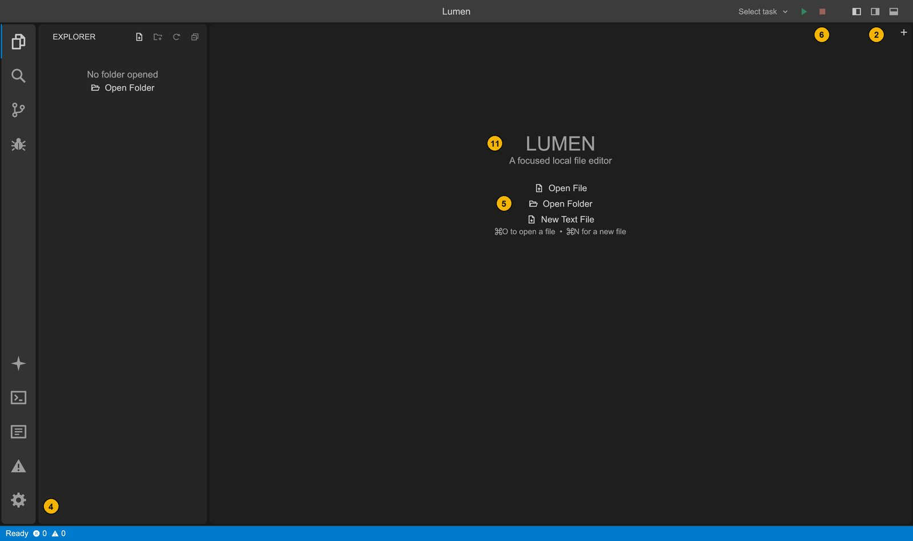

**Welcome.** The three actions render as plain text (5), and the hint line sits
directly under them. Nothing says what Lumen can do (11). The left-sidebar toggle
is on, but it looks the same as the two toggles that are off (2). Stop is
disabled but still red (6). "Ready" stays in the status bar (4).

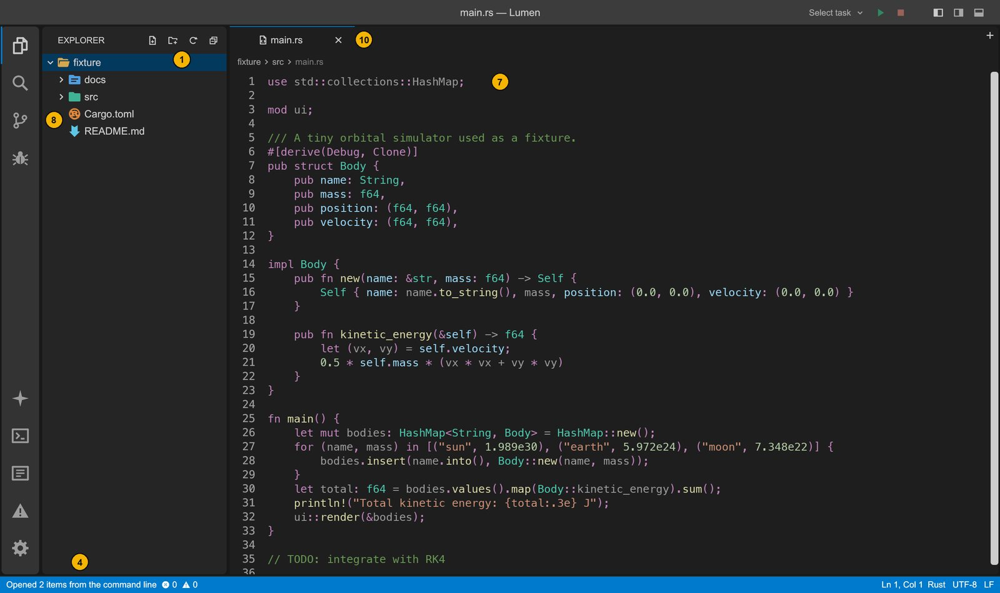

**Workbench.** The Explorer header actions have no hover or pressed state (1).
Source Control shows no change count although the repository has changes (8).
Every tab draws its × at all times (10). There is no current-line highlight or
indent guide (7). "Opened 2 items from the command line" stays for the whole
session (4).

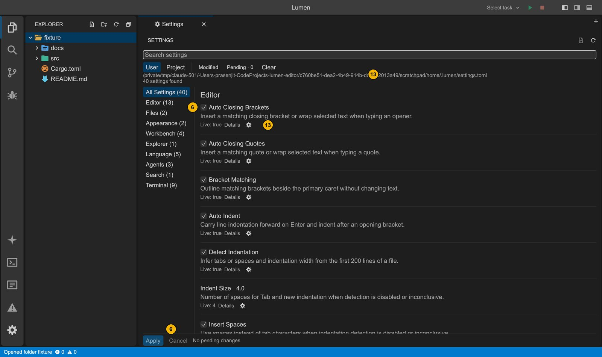

**Settings.** Checkboxes have no border, so an unchecked box nearly disappears
(6). Apply is disabled but still blue (6). Every row repeats "Live: true ·
Details · ⚙", and the full settings-file path sits above the list (13).

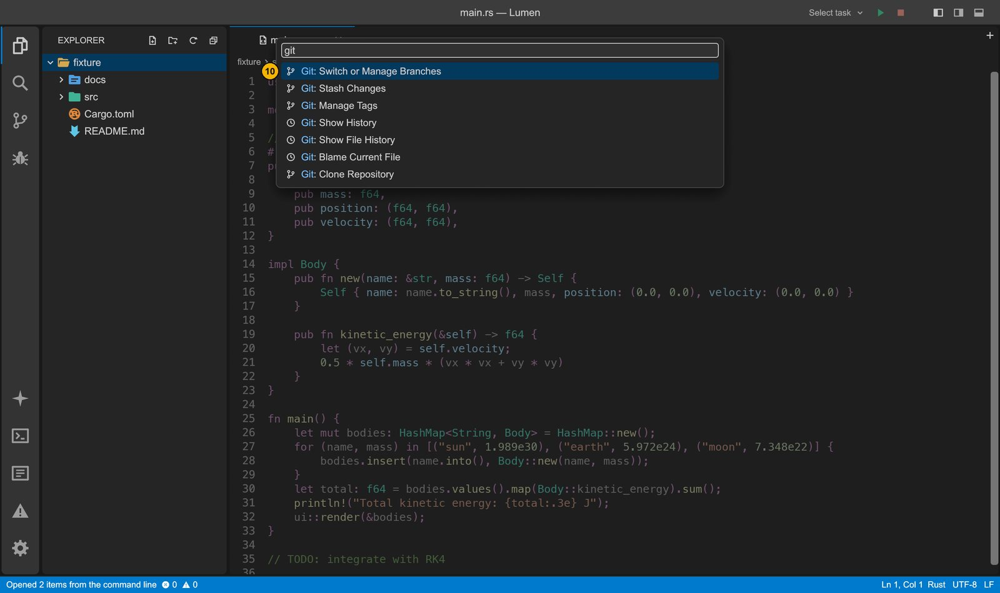

**Command palette.** Results don't show which characters matched the query (10).

## Proposed screens

These are rendered from the mockup. In each pair the top half reproduces
today's behavior and the bottom half shows the proposal, with the same content
and the same action.

### Workbench at rest

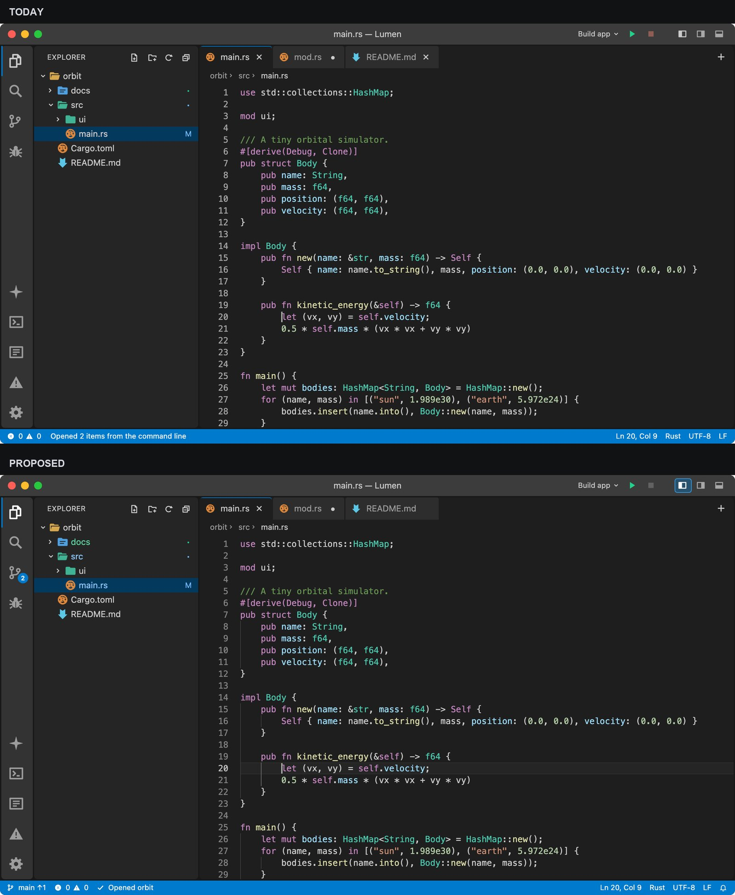

In the proposal the left-sidebar toggle reads as on (2) and Source Control
carries a change count (8). Changed file names take their Git color (8). The
editor shows the current line, a brighter active line number and indent guides,
with the enclosing block's guide emphasized (7). The status bar gains a branch
item (9), and the stale message is replaced by a short-lived "Opened orbit" (4).

### Committing

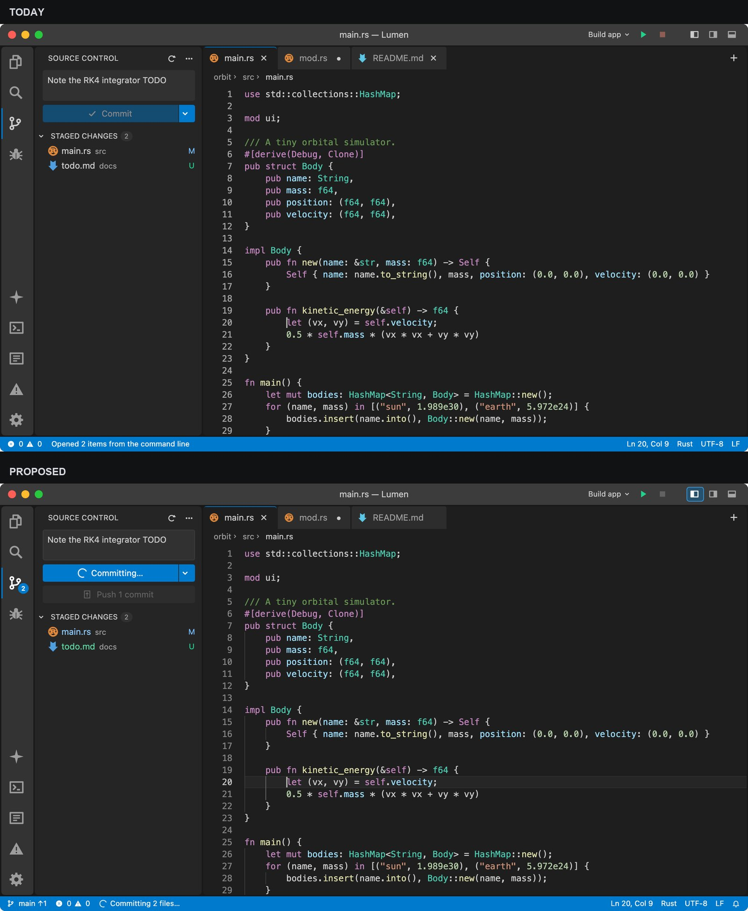

Today the Commit button just fades while the commit runs. In the proposal it
shows a spinner and "Committing…", and the status bar shows the same progress
(3). The Push button that appears when there are commits to push is disabled
while another Git operation runs.

### Pushing

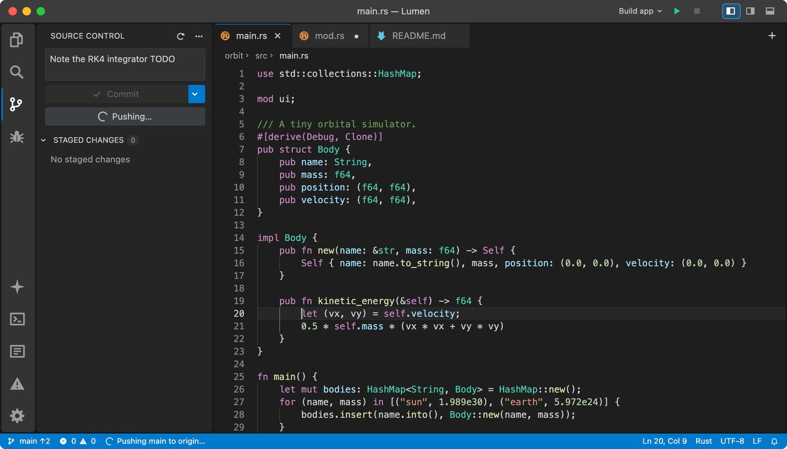

The Push button under Commit appears when the branch is ahead of its upstream.
While pushing, it shows "Pushing…" and the status bar shows "Pushing main to
origin…". When the push finishes, the button flashes a check, the status bar
says "Pushed 2 commits to origin/main" and then fades out (3, 4).

### A failed pull

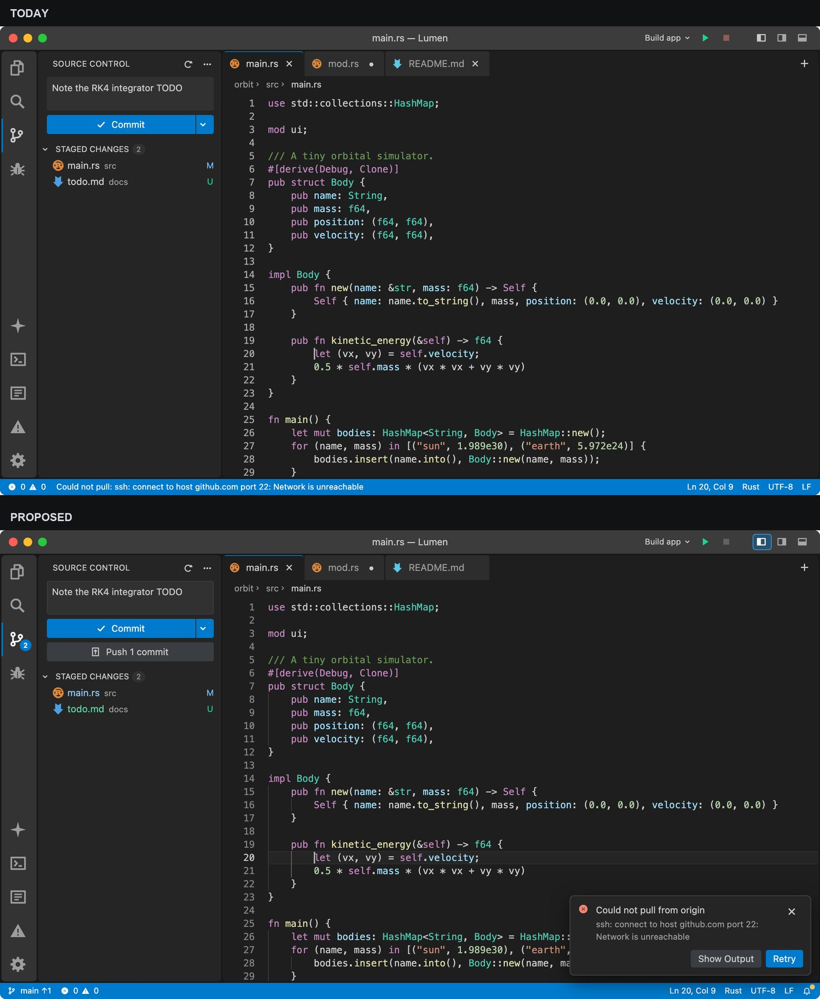

Today the error replaces the status line in the same white text as any success
message, and nothing marks it as a failure. In the proposal, a toast with an
error icon stays until it is dismissed and offers **Show Output** and **Retry**.
The bell in the status bar marks it as unread (4).

### Running a task

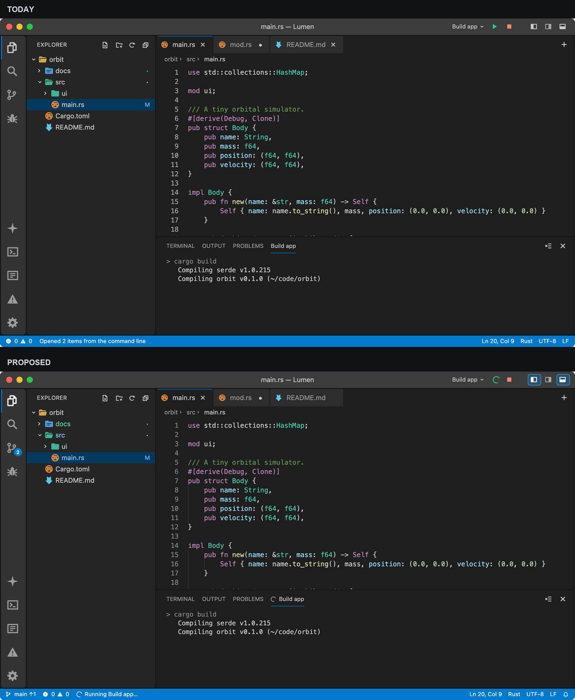

Today the Run button looks the same while the task runs, and Stop is red whether
or not it can be used. In the proposal Run becomes a spinner, Stop turns red
only while it can stop something, the task tab shows a spinner, and the status
bar says "Running Build app…" (3, 6). The bottom-panel toggle reads as on (2).

### Control states

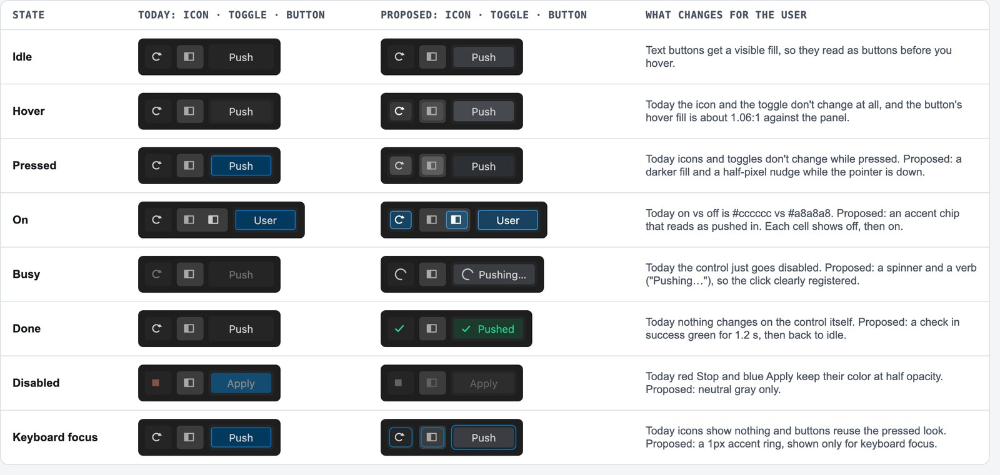

This table is the specification for the shared controls in finding 1. Each row
shows a toolbar icon, a panel toggle and a text button. Today several rows look
identical; that is the core of the "did my click register?" problem.

### Welcome

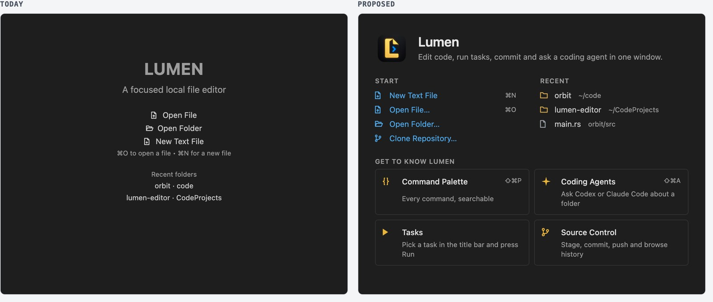

The proposal uses only commands that exist today (finding 11).

## Findings

Priority: **Phase 1** changes how responsive the app feels, **Phase 2** adds
orientation, **Phase 3** is presentation and finish. Size: **S** is one
component or primitive, **M** is several coordinated components, **L** is wider
architecture. File references are relative to `src/` unless noted.

### Phase 1: make every click answer

#### 1. Icon buttons don't react to hover, press or keyboard focus (M)

**Problem.** With `frame(false)` egui paints no background in any state, and the
theme gives idle, hovered and pressed widgets the same text color
(`ui/theme.rs:322-335`). The activity bar (`ui/widgets.rs:711`, `icon_button`),
the panel toggles (`ui/task_launcher.rs:54-65`) and Run/Stop
(`ui/task_launcher.rs:111-135`) set a transparent fill and a fixed `RichText`
color, so they never change either. Header actions (`ui/widgets.rs:269`) and
disclosure-row actions (`ui/widgets.rs:557`) are frameless. A keyboard-focused
frameless button shows nothing at all.

**Change.**

- Add the control roles from [Control state specification](#control-state-specification)
  to `Palette` in `ui/theme.rs`.
- Add `widgets::tool_button(ui, ToolButton { glyph, tooltip, enabled, on, busy, done })`.
  It allocates a fixed rect, paints the state fill and glyph, applies
  `widgets::named()`, and returns the `Response`. Callers keep their own `put`
  rect and ID salt so widget IDs don't change.
- Migrate the header actions, disclosure-row actions, activity bar, panel
  toggles, Run/Stop, tab close buttons, Find and Terminal header actions, and
  the remaining `frame(false)` icon buttons. Text-style links (recent files,
  breadcrumbs) move to a `link_button()` that underlines on hover instead.

**Acceptance.** Hovering any icon button paints `control_hover`. Holding the
pointer down paints `control_pressed`. Keyboard focus paints a 1px accent ring
that hover doesn't. No migrated button changes its rect, ID or command. Header
geometry tests (`resizing_keeps_title_left_and_commands_at_the_right_edge` and
the related tests) still pass unchanged.

#### 2. Toggles don't show whether they're on (S)

**Problem.** The panel toggles in the title strip are on or off only by glyph
color: `#cccccc` against `#a8a8a8` on `#3c3c3c` (`ui/task_launcher.rs:27-74`).
In the capture the "on" left-sidebar toggle is indistinguishable from the two
"off" ones. Find's **Aa** and **ab** options (`ui/editor_find.rs:102-113`) use
`selectable_label`, which does fill when selected, but in a different style from
everything else.

**Change.** Draw the "on" state with `tool_button(.. on: true ..)`: a
`control_on` fill, a 1px `control_on_edge` inset and a full-brightness glyph.
Tooltips name the action ("Hide Left Sidebar" or "Show Left Sidebar") rather
than "Toggle…". Expose the selected state through `WidgetInfo::selected`. Move
the Find options to the same style.

**Acceptance.** In each theme, a capture of the title strip with one panel open
shows exactly one chip. The accessibility tree reports selected or not selected
for each toggle. Clicking a toggle still dispatches the same `Command`.

#### 3. Slow actions look like nothing happened (M)

**Problem.** Commit, push, pull, fetch, publish, stash and clone run on
background threads (`app/source_control.rs:699-788`). `begin_source_mutation`
(`app/source_control.rs:259-267`) only sets `loading = true`, which disables the
buttons. No "Pushing…" or "Committing…" text exists anywhere, and the UI has
three spinners in total (CSV, image and Markdown loading). Pull, Push and Fetch
are only reachable from the repository's ⋯ menu
(`ui/source_control_menu.rs:27-35`). A running task leaves the Run button
unchanged.

**Change.**

- Give `SourceControlJob` an operation kind (`Commit`, `Amend`, `Push`, `Pull`,
  `Fetch`, `Publish`, `Stash`, `Clone`, `Stage`, `Discard`, …). The control that
  started the job shows the busy state: a spinner and a verb in place of its
  glyph or label. Other mutating controls stay disabled, as they are today.
- Record the last completed job as `(kind, finished_at, outcome)`. On success,
  the originating control shows the done state for 1.2 s. On failure, the error
  becomes an Error notice (finding 4).
- Add a visible **Push n commits** button under Commit when the branch is ahead
  and not behind, and **Pull n commits** when it is behind. Keep Pull, Push and
  Fetch in the ⋯ menu as well.
- While a selected task is running (`task_runs.active_for`), Run shows the busy
  state. A run that exits with code 0 shows done. A failed run posts an Error
  notice with a **Show Output** action that selects the task tab.
- Anything that runs longer than 300 ms also posts a progress item to the status
  bar ("Pushing main to origin…", "Running Build app…").

**Acceptance.** Pressing Commit, Push, Pull or Run changes the pressed control
within the same frame. The busy state persists until the job's result is
received and is cleared on success, on failure and on cancel. Operations faster
than 300 ms don't flash a status-bar progress item. Tests use the injected
`SourceControlService` and a fake task runner. They don't touch real Git or
sleep.

#### 4. Results land in one easy-to-miss status line (M)

**Problem.** 218 code paths write `view.status` (`app/view_state.rs:499`), and
the status bar renders it as 11px white text with no icon
(`ui/chrome.rs:256-271`). Errors and successes look the same, and a message
stays until another one replaces it.

**Change.** Replace the string with a notice model; see
[Notice model](#notice-model). Info and success messages show in the status bar
with an icon and fade after 5 s. Errors become a toast that stays until it is
dismissed and can carry one action. A bell at the right end of the status bar
opens the history and shows an unread dot. Migrate the error messages first,
then the rest, then remove direct writes to `view.status`.

**Acceptance.** An Error notice is still visible after 60 s of synthetic time.
An Info notice is gone 5 s after posting. A toast never takes keyboard focus or
consumes a key event. Existing tests that assert on `view.status` (for example in
`ui/activity_bar.rs`) assert on the notice text instead.

#### 5. Text buttons look like labels (S)

**Problem.** `ui/theme.rs:329-346` sets the idle `weak_bg_fill` to transparent,
so "Open File", "Open Folder", "Details" and "Clone Repository…" read as plain
text until hovered (`ui/editor.rs:125-142`, `ui/source_control.rs:388-404`). The
hover fill, `#2b2b2b` on the `#252526` panel, measures about 1.06:1. Pressed and
keyboard focus share the same look (`active` fill with an accent stroke).

**Change.** Give ordinary buttons the secondary fills from the specification and
keep the accent fill for the one primary action in a view. Give keyboard focus
its own ring, separate from pressed. Use `link_button()` (finding 1) wherever
text should read as a link.

**Acceptance.** In a capture, every enabled text button reads as a button without
hovering. Pressed and focused look different. Primary buttons keep `on_accent`
text, which already has a contrast test.

#### 6. Checkboxes and disabled controls are ambiguous (S)

**Problem.** The checkbox box is `#313131` on `#1e1e1e` with no border, so an
unchecked box nearly vanishes (Settings, and the Problems filters in
`ui/problems.rs:90-94`). Disabled controls keep their semantic color at egui's
disabled opacity: Apply stays blue (`ui/settings.rs:490-495`) and Stop stays red
(`ui/task_launcher.rs:111-122`).

**Change.** Give checkboxes a 1px `checkbox_border` stroke and an accent fill when
checked. Draw disabled controls with `disabled_bg` and `disabled_fg`, never a
faded semantic color, and keep their disabled-reason tooltips.

**Acceptance.** A test renders disabled Apply and Stop and finds neither the
accent nor the error color among their shapes. An unchecked checkbox draws a
border stroke in every theme.

### Phase 2: make state visible at a glance

#### 7. The editor lacks current-line and indentation cues (M)

**Problem.** The editor surface draws no current-line highlight, the active line
number looks like every other one, and there are no indent guides. No such code
exists in `crates/editor-surface/src/`; bracket matching does exist.

**Change.**

- Draw a current-line band behind each caret's logical line, covering every
  visual row of a wrapped line, when that caret's selection is empty.
- Brighten the gutter number of each line that holds a caret.
- Draw indent guides at each indentation step, using the detected or configured
  indent size. Blank lines take the smaller indentation of their neighbors.
  Emphasize the guide of the block that encloses the primary caret.
- Paint in this order: background, line band, guides, selection, text.
- Derive every position from the text galley and the shared viewport, as the
  single-layout-authority rule in `AGENTS.md` requires. Cull to visible rows,
  respect folded ranges, and never move the caret or selection.
- Add `editor.highlight_current_line` and `editor.indent_guides` (both
  booleans, default on) to `crates/settings-core/src/editor.rs`.

**Acceptance.** The band and guides line up with the text at every font size and
UI scale, and under horizontal scroll, wrapping and folding. With either setting
off, nothing is drawn. Existing editor-surface tests and caret and selection
behavior are unchanged.

#### 8. Nothing tells you something changed (S)

**Problem.** The only activity-bar badge is the agent attention dot
(`ui/activity_bar.rs:94-101`). Source Control shows no count of changed files and
Problems shows no error count. Explorer rows show a Git letter, but the file name
keeps the default color (`ui/widgets.rs:626-709`).

**Change.** Git state is only read while the Source Control pane is open, so also
refresh it in the background (once on opening a folder, then every 30 s while the
pane is closed). Add count badges, capped at "99+", on Source Control (changed files
across loaded repositories) and on Problems (errors). Both counts come from
state that is already loaded. Add the count to each accessible name, for example
"Source Control, 2 changes". Tint changed Explorer names with
`theme::change_color`, the color their letter already uses.

**Acceptance.** Badges appear and clear as the snapshot and diagnostics change,
and the badge pops once when its count changes (finding 12). Tinted names keep a
contrast of at least 4.5:1 on the panel and on the selection fill in every
theme.

#### 9. Status bar items don't look clickable (S)

**Problem.** Problems, Ln/Col and the language-server label are clickable
(`ui/chrome.rs:272-334`), but they have no hover fill and no pointer change. The
branch and its push/pull state appear only inside Source Control.

**Change.** Give clickable status items a white 14% hover fill, a 22% pressed
fill and a pointer cursor. Add a branch item ("main ↑1") from the existing
snapshot that opens Source Control. Show a short SHA on a detached HEAD, and hide
the item when no repository is loaded. Extend the existing drop order under width
pressure: language/EOL first, then the server state, then the branch. Position
and problem counts stay.

**Acceptance.** Status-bar width tests cover the branch item at narrow widths.
Clicking it dispatches `ActivateActivity(SourceControl)`.

#### 10. Tabs give little feedback (S)

**Problem.** Inactive tabs have no hover state, and every tab draws its close ×
at all times (`ui/editor_tabs.rs:901-984`). (The first draft of this plan also
said the command palette and Quick Open don't highlight matches; they do, via
`ui/match_highlight.rs`, so that part is dropped.)

**Change.** Add a tab hover fill. Show × on the active tab and on hovered tabs.
Unsaved tabs keep their dot, which turns into × on hover as it does today. Always
allocate the × area so the tab layout never shifts.

**Acceptance.** Tab sizing tests in `ui/editor_tabs/tests.rs` pass unchanged.
Middle-click close, the context menu and ⌘W/Ctrl+W behave as before.

### Phase 3: first impression and finish

#### 11. The welcome screen undersells the app (S–M)

**Problem.** The welcome screen shows a grey "LUMEN" wordmark, three text-only
buttons and a hint line directly underneath (`ui/editor.rs:114-153`). It doesn't
mention agents, Git, tasks or the terminal. The app icon is used only for the
window and Dock.

**Change.** Show the app icon and name with a one-line description. Decode
`assets/icons/lumen.png` once with the existing `image` dependency
(`bootstrap.rs` already embeds it) and load it with `ctx.load_texture`. Below
that:

- a **Start** column: New Text File, Open File…, Open Folder…, Clone
  Repository…;
- a **Recent** column with the existing recent folders and files;
- **Get to know Lumen**: Command Palette, Coding Agents, Tasks and Source
  Control, each with its platform shortcut from `ui/shortcut.rs`.

Every entry dispatches an existing command. Keep the layout compact and flat,
with no gradients. Collapse to one column in narrow or short editor groups.

**Acceptance.** Each entry dispatches its existing command. The page fits without
overflow in a 220 px-wide split group and a 300 px-tall group. Missing recent
entries still fail safely, as they do today.

#### 12. Nothing moves (S, after finding 1)

**Problem.** Hover fills, toggles, panels and status messages all snap. Combined
with finding 1, this makes the UI feel unresponsive.

**Change.** Use `ctx.animate_bool_with_time` (egui 0.33) to fade hover and
toggle fills over 100–150 ms and to fade status messages out. Slide toasts in
over about 180 ms, keep busy controls spinning, and pop a badge when its count
changes. Add `appearance.reduce_motion` (boolean, default off). When it is on,
fades and slides are instant; spinners still turn, because they convey state.
Repaints are requested only while an animation runs.

**Acceptance.** With no animation running, Lumen requests no extra repaints. With
`reduce_motion` on, the same tests see final states in the first frame.

#### 13. Settings rows are noisy (S)

**Problem.** Every row repeats "Live: true · Details · ⚙", and the full
settings-file path sits above the list as a long line of text (`ui/settings.rs`,
`setting_row` and the toolbar).

**Change.** Show origin metadata only when a value differs from its default. Show
Details and the gear when the row is hovered or focused. Replace the path line
with an "Open settings file" link that shows the full path on hover and in its
context menu.

**Acceptance.** More settings fit in the same viewport without smaller text.
Pending and Draft/Live markers from the earlier Settings work are unchanged.

## Control state specification

These are starting values for the new `Palette` roles. Confirm each one with the
contrast tests in `ui/theme.rs` before merging. Dark values match the mockup.

| Role | Dark | Light | High Contrast |
| --- | --- | --- | --- |
| `control_hover` | white α 9% | black α 6% | 1px `border` outline, no fill |
| `control_pressed` | white α 17% | black α 12% | white α 25% |
| `control_on` (fill) | `accent` α 34% | `accent` α 16% | none |
| `control_on_edge` | `#3ca0e8` α 90%, 1px inset | `accent`, 1px inset | `accent` (yellow), 1px |
| `button_secondary` / hover / pressed | `#3a3d41` / `#46494e` / `#2c2f33` | `#e1e4e8` / `#d4d8dd` / `#c8ccd1` | black / `control_hover` / `control_pressed`, with a 1px `border` |
| `disabled_bg` / `disabled_fg` | `#2d2d2d` / `#626262` | `#ececec` / `#a0a0a0` | black / gray 140 |
| `checkbox_border` | `#6b6b6b` | `#8a8a8a` | white |
| focus ring | 1px `accent` | 1px `accent` | 1px `accent` |
| `success` (done) | existing | existing | existing |

| State | Toolbar icon | Toggle | Text button |
| --- | --- | --- | --- |
| Idle | glyph `text`, no fill | glyph `title_muted` (off) | `button_secondary` (primary: `accent`) |
| Hover | `control_hover`, glyph bright | `control_hover` | secondary hover (primary: lighter accent) |
| Pressed | `control_pressed`, glyph nudged 0.5px | `control_pressed` | secondary pressed, label nudged 0.5px |
| On | `control_on` + edge, glyph bright | `control_on` + edge | `control_on` + edge (segmented choices) |
| Busy | spinner replaces glyph | — | spinner + present-tense verb ("Pushing…") |
| Done | check in `success` for 1.2 s | — | check + past tense ("Pushed") for 1.2 s |
| Disabled | glyph `disabled_fg` | glyph `disabled_fg` | `disabled_bg` + `disabled_fg` |
| Keyboard focus | 1px ring | 1px ring | 1px ring, offset 2px |

Rules:

- Disabled never keeps a semantic color.
- Focus is drawn only for keyboard focus, never for pointer presses.
- Busy and done replace the content inside the same rect; the control never
  resizes.

## Notice model

Notices live in a new `app/notices.rs`. It has no egui dependency and takes the
current time as an argument, so tests use synthetic time. Rendering lives in a
new `ui/notices.rs`, and the status bar keeps its layout in `ui/chrome.rs`.

```rust
pub(crate) enum Severity { Info, Success, Warning, Error }

pub(crate) struct Notice {
    pub(crate) severity: Severity,
    pub(crate) text: String,
    pub(crate) detail: Option<String>,
    pub(crate) action: Option<(String, Command)>,
    pub(crate) posted_at: f64,
}

pub(crate) struct Progress {
    pub(crate) label: String,
    pub(crate) started_at: f64,
}
```

| Kind | Where | Lifetime | Icon |
| --- | --- | --- | --- |
| Progress | status bar, newest first ("+1" when more) | until the job ends; shown after 300 ms | spinner |
| Info | status bar | fades 5 s after posting | info |
| Success | status bar | fades 5 s after posting | check |
| Warning | toast and history | auto-dismiss after 10 s | warning |
| Error | toast and history; unread dot on the bell | until dismissed | error |

- Show at most three toasts. A fourth moves the oldest into history. Identical
  text coalesces into one toast with a count.
- Toasts never take focus and add no global key bindings, so they can't
  intercept typing (see `AGENTS.md`). Dismiss them with × or from history.
- Toasts appear bottom-right, above the status bar, inside the workbench
  surfaces.
- Migration: add `notify(severity, text)` and a temporary `status(text)` that
  maps to Info. Convert the error paths first, then the rest, and then delete
  `view.status`.

## Delivery

Five reviewable PRs. Each one keeps widget IDs and render order, adds regression
tests, and records before/after captures.

| PR | Scope | Findings | Exit condition |
| --- | --- | --- | --- |
| 1. Control states | Theme roles; `tool_button()`, toggle and `link_button()`; secondary and primary fills; checkbox border; disabled style; migrate every icon button | 1, 2, 5, 6 | Every enabled control shows hover, pressed and focus; disabled controls carry no semantic color; header, tab and activity tests pass unchanged |
| 2. Progress and notices | Operation kinds for Git jobs, busy and done states, status-bar progress, notice model, toasts, bell, Push/Pull button, task Run state | 3, 4 | No `view.status` writes remain; errors persist and info expires under synthetic time; Git and task tests cover success, failure and cancel |
| 3. Glanceable state | Activity badges, Explorer name tint, status-bar hover and branch item, tab hover and close behavior, background Git refresh | 8, 9, 10 | Badge, status-width and tab-sizing tests pass at 900, 1280 and 1920 px |
| 4. Editor cues | Current line, active line number and indent guides in editor-surface, plus two settings | 7 | Alignment holds across font size, scale, wrap, scroll and fold; settings turn each cue off |
| 5. Welcome and motion | New welcome screen, transitions, `reduce_motion`, Settings row cleanup | 11, 12, 13 | Welcome fits 220 px groups; no idle repaints; reduce-motion tests pass |

PR 1 alone fixes the "did my click register?" problem across the app and should
land first. PR 2 depends on PR 1's busy and done states. PRs 3–5 are independent
of each other.

## Verification

- Run `cargo fmt --all --check`, `cargo test --workspace` and
  `cargo clippy --workspace --all-targets -- -D warnings` for every PR. Run
  `cargo check --target x86_64-pc-windows-gnu` when the target is installed and
  `cargo xtask bundle` on macOS for the chrome changes in PRs 1 and 3.
- Extend the render-level tests that inspect `output.shapes`, using the
  `active_stripes` pattern in `ui/activity_bar.rs`. Assert that a hovered button
  paints `control_hover`, a pressed one paints `control_pressed`, a toggle paints
  `control_on` only when on, and a focused one paints the ring.
- Capture before and after images with `LUMEN_CAPTURE` on the same disposable
  fixture in Dark, Light and High Contrast. PR 2 should add a debug-only `scm`
  step to `LUMEN_CAPTURE_COMMANDS`, since Source Control has no capture command
  today.
- Do not claim Windows, Linux or screen-reader behavior from compilation alone.
  Record which platforms were run.

## Decisions

The plan assumes the recommended option for each of these. Change it here before
PR 1 if needed.

1. **Toggle "on" style.** Recommended: an accent-tinted chip with a 1px edge, as
   in the mockup. The alternative, a neutral grey chip, is quieter but easier to
   miss.
2. **When to use toasts.** Recommended: errors, warnings and anything that needs
   a decision. Routine successes stay in the status bar and fade out.
3. **Tab close button.** Recommended: show × on the active tab and on hover, as
   VS Code does. Today every tab shows it.
4. **Status-bar branch item.** Recommended: add it. It is a small new item built
   from data the snapshot already has.

## Scope boundaries

- Keep the compact VS Code-style density, row heights, 5px pane corners and the
  2px gutter. Keep the Dark palette values listed in `AGENTS.md`; new roles are
  added and none are changed.
- Keep native traffic lights and menus, the system UI font and the monospace
  editor font.
- No gradients, floating cards or new permanent toolbars.
- No new Git operations, task features, agent behavior or editor commands. The
  Push and Pull buttons call the existing commands.
- Document safety, dirty flags, dialogs, clipboard rules and command routing are
  unchanged. Any functional defect found during this work goes in a separate
  issue rather than into these PRs.
